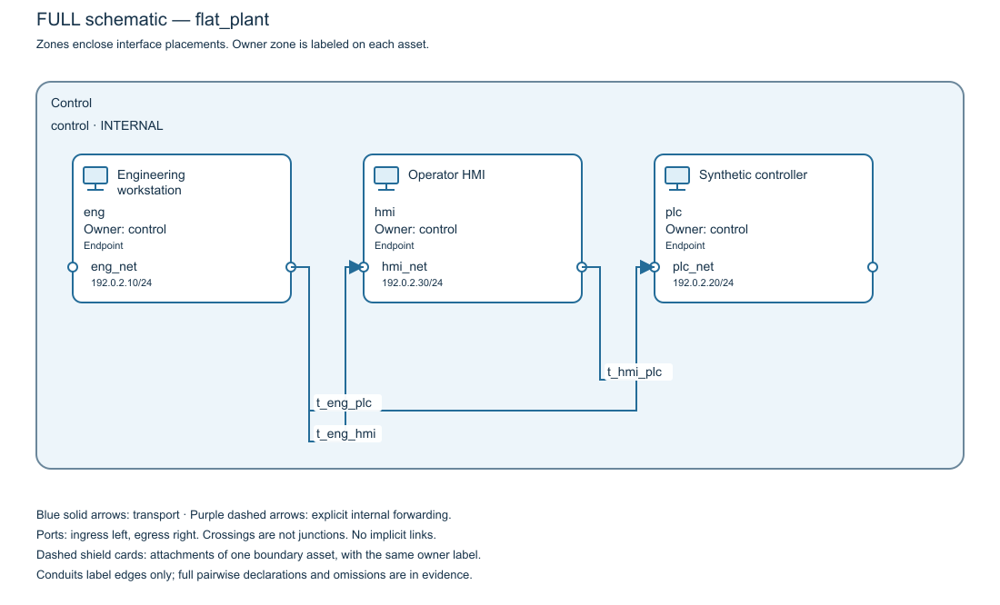
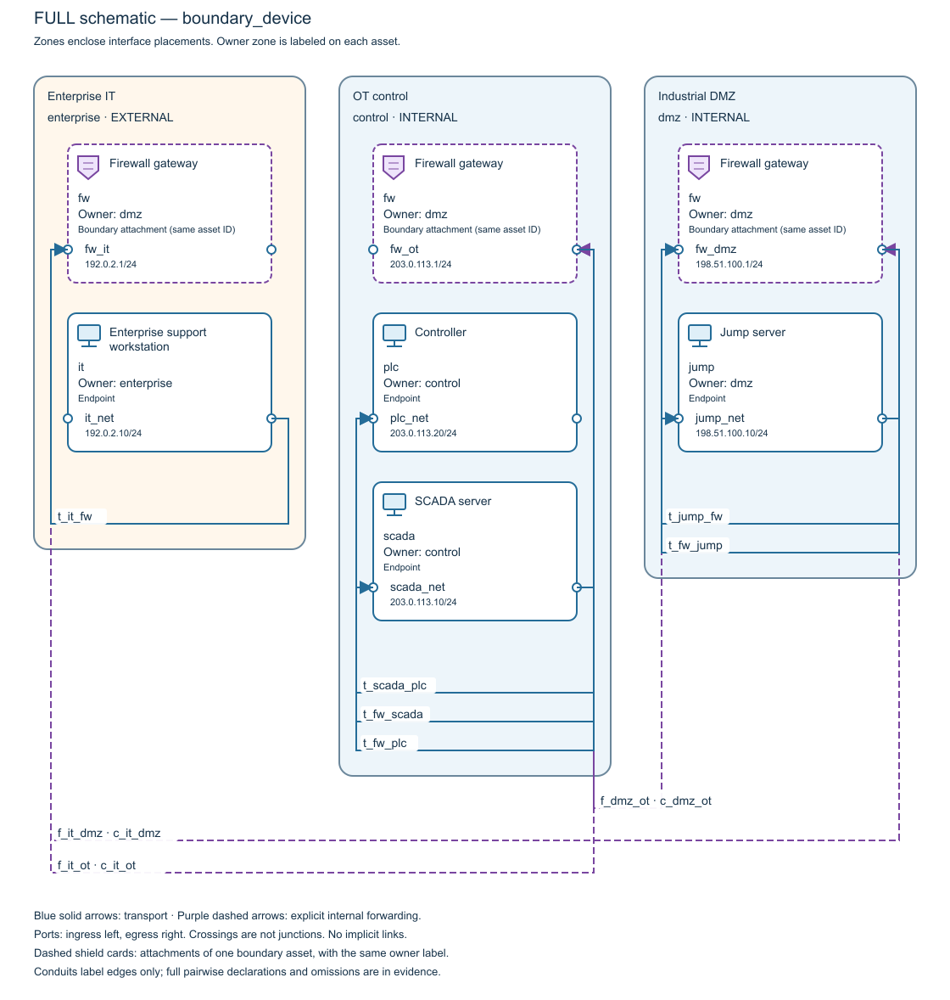

# OT-ArchGuard

OT-ArchGuard is an offline Python CLI for reviewing declared IT/OT network
architectures. It validates architecture models, checks communication requirements
and compares TCP/UDP listener reachability between proposed configurations.

Source version: **1.1.0**. YAML schema: **1**. Consult the owner-published release
record for availability, exact source tag and audited asset checksums.
See [release notes](docs/release-notes-1.1.0.md)
and [Gate V11-6 verification](docs/v1.1/gate-v11-6.md).

OT-ArchGuard is an independent industrial network architecture analysis tool inspired by general OT cybersecurity good practices, including those addressed by the IEC 62443 series. It does not provide certification, establish normative conformity or imply institutional endorsement.

## What it analyzes

- Strict bounded YAML with typed references, placements and canonical SHA-256 hashes.
- Directed interface-state paths with explicit transport and boundary forwarding.
- Original source/destination endpoints and unordered deny-overrides-allow policies.
- Exact destination-port intervals and deterministic, replayable path witnesses.
- Independent required/prohibited communication intents and finite exposure comparisons.
- JSON and offline HTML/SVG reports with provenance and explicit omission manifests.
- Planned and actual resource limits with controlled rejection diagnostics.

Zones, subnets, roles, conduits and reachable applications create no implicit paths.
Reduced exposure does not cancel a failed operational requirement.

## Install and run

Python 3.12 or later is required. Local verification covers Windows with Python
3.12.14 and 3.14.5; see [historical V11-6 verification](docs/v1.1/gate-v11-6.md).
From a checkout or extracted source distribution:

~~~powershell
py -3.12 -m venv .venv
.\.venv\Scripts\python.exe -m pip install .
.\.venv\Scripts\python.exe -m pip check
.\.venv\Scripts\otarchguard.exe --version
.\.venv\Scripts\otarchguard.exe validate examples/remote-support/baseline.yaml
.\.venv\Scripts\otarchguard.exe check examples/remote-support/baseline.yaml
New-Item -ItemType Directory -Force output | Out-Null
.\.venv\Scripts\otarchguard.exe exposure examples/remote-support/baseline.yaml --scenario support_scope --report output/exposure.html
~~~

Installation requires access to compatible dependencies, either online or through
a prepared wheelhouse. Runtime analysis and reports require no network service,
JavaScript or external renderer. See [installation](docs/installation.md) and
[synthetic examples](examples/README.md).

| Exit | Meaning |
| --- | --- |
| 0 | Valid declaration or completed analysis without failed intents |
| 1 | Completed analysis with failed intents on either comparison side |
| 2 | Invalid/unsupported input, resource exhaustion, execution or I/O failure |

JSON results go to stdout; fatal diagnostics go to stderr. Specify --report-format
json for JSON report files. Create report parent directories and keep outputs
separate from inputs. Fatal errors preserve existing reports; check the native exit.

## Examples and technical documentation

| Example | Baseline to proposal observations | Finding |
| --- | --- | --- |
| Segmented plant | 5 to 6 | Added enterprise-to-controller access violates a prohibition |
| Flat plant | 3 to 1 | Reduced exposure breaks required HMI communication |
| Remote support | 4 to 5 | Added explicit forwarding exposes a controller |

These version 1.0.1 previews show invented models. Boundary attachment cards sharing
one ID represent one device. Arrows represent declared transitions; they do not
establish permitted communication or physical connectivity.

The v1.1.0 renderer adds topology-informed deterministic zone order,
repeatable HTML `--zone-order` preferences, numbered orthogonal routes and local
report navigation. See [report options](docs/reporting.md) and
[Gate V11-2 evidence](docs/v1.1/gate-v11-2.md). Its six native OS/Python CI
combinations cover Windows, Ubuntu and macOS with Python 3.12/3.14.
Acceptance evidence must identify the exact reviewed release source.

Read the [schema](docs/yaml-schema-v1.md), [domain model](docs/domain-model.md),
[algorithms](docs/algorithms.md), [requirements](docs/requirements.md),
[reporting guide](docs/reporting.md), [testing strategy](docs/testing-strategy.md),
[boundary example](docs/boundary-device-example.md) and
[release verification checklist](docs/release-checklist.md).

## Limitations and license

The tool evaluates finite declared initiation paths. It does not verify deployed
inventory, sessions, return traffic, authentication, vulnerabilities, compromise,
availability, physical risk or process safety. Completeness, classification and
criticality are user assertions; security-level evidence remains unassessed.
See [known limitations](docs/limitations.md). Version 1.1.0 corrects the historical
v1.0.1 invalid-Unicode diagnostic issue.

Project code and documentation use [Apache-2.0](LICENSE). Dependencies retain
their own [licenses and notices](THIRD_PARTY_NOTICES.md).
## Exact communication trace

Version 1.1.0 adds
`otarchguard trace MODEL --source ASSET --service SERVICE [--destination ASSET]`
with optional `--policy-evidence`, `--report PATH` and `--report-format html|json`.
Exit 0 means the exact declared query completed, including unreachable or mixed
port outcomes. Intents remain unassessed by trace. See the [trace contract](docs/trace.md)
and [synthetic trace examples](examples/README.md#exact-communication-trace).
Application and distribution versions are 1.1.0. Evaluate upgrades in a parallel
environment; see [installation and upgrade](docs/installation.md). Consult the
owner-published release record for available assets, source tag and checksums.

For v1.2, easier architecture authoring is a required future adoption goal:
guided creation, industrial templates, spreadsheet/CSV import, schema-1 YAML
generation, understandable validation and progressive visual editing. These
capabilities are planned and are absent from v1.1.0.
