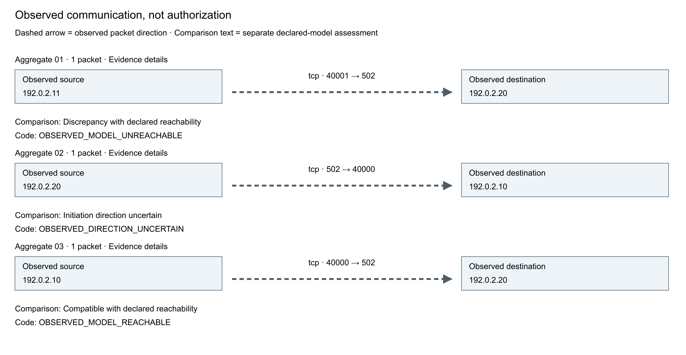
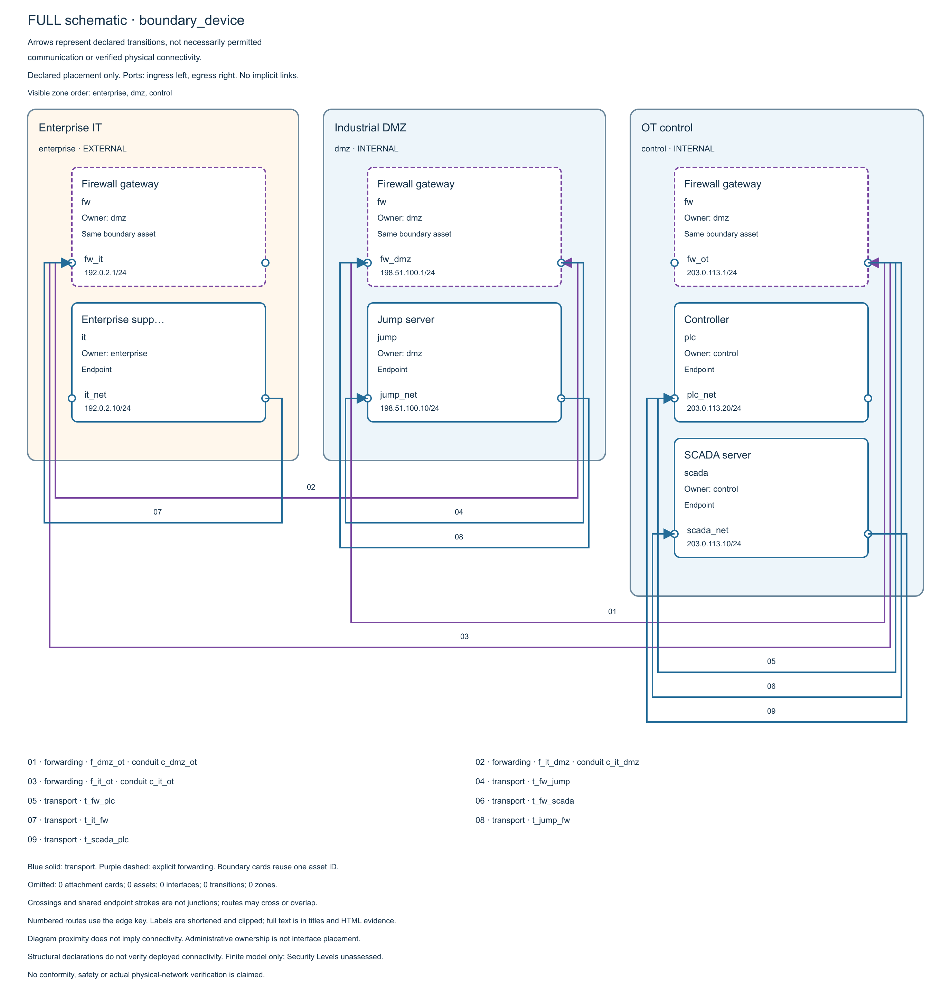

# OT-ArchGuard

OT-ArchGuard is an offline Python CLI for reviewing declared IT/OT network
architectures and comparing supported passive network evidence with those
declarations. It combines architecture analysis, reviewed data import and
navigable local reports.

Use it to review proposed segmentation, explain declared communication paths and
compare supported capture observations with the architecture model.

**Latest stable release: [v1.3.0](https://github.com/z4y-d3n/OT-ArchGuard/releases/tag/v1.3.0).**
Requires **Python 3.12 or later**. Native YAML schema: **1**.

[Capabilities](#capabilities) · [Visual previews](#visual-previews) · [Install and run](#install-and-run) ·
[Examples](#examples-and-technical-documentation) · [Verification](#release-verification) ·
[Limitations](#limitations-and-license) · [Changelog](CHANGELOG.md)

## Capabilities

| Capability | What you can do | Start here |
| --- | --- | --- |
| **Architecture Analysis** | Validate declared models, evaluate exact communication paths and compare reachability and exposure | [Schema](docs/yaml-schema-v1.md), [trace](docs/trace.md), [examples](examples/README.md) |
| **Import Studio** | Combine supported inventories, diagrams and documentary observations through explicit owner review | [Import guide](docs/import-studio.md), [multi-source walkthrough](examples/import-studio/projects/README.md) |
| **Architecture Explorer** | Navigate zones, assets, interfaces, provenance and explicit analytical queries in offline reports | [Explorer walkthrough](examples/explorer/README.md) |
| **PCAP Evidence Studio** | Inspect supported captures, review address associations and reconcile observations with the declared model | [Capture guide](docs/pcap-evidence-studio.md), [fictional tutorial](examples/capture-studio/README.md) |

### Visual previews

These are complete native diagram previews generated by the released v1.3.0
application from fictional data, not browser screenshots. The offline HTML
reports retain the navigation, full labels and underlying evidence.

**PCAP Evidence Studio — observed traffic and separate model assessment**

The compact three-record preview uses established tutorial frames. It is separate
from the packaged ten-record and extended twelve-record demonstrations.
[Run the capture walkthrough](examples/capture-studio/README.md).

**Architecture Explorer — owner-declared architecture**

The remote-support example shows one boundary asset across its interface
placements. Arrows are declarations, not proof of deployed connectivity or
permission. Native forwarding is solid purple in this Explorer view; its reused
SVG legend still says "purple dashed". The preview preserves that released
presentation quirk. [Explore the architecture](examples/explorer/README.md) and
[inspect image provenance and reproduction](docs/images/README.md).

### Architecture Analysis

- Strict bounded YAML with typed references, placements and canonical SHA-256 hashes.
- Directed interface-state paths with explicit transport and boundary forwarding.
- Original source/destination endpoints and unordered deny-overrides-allow policies.
- Exact destination-port intervals and deterministic, replayable path witnesses.
- Independent required/prohibited communication intents and finite exposure comparisons.
- JSON and offline HTML/SVG reports with provenance and explicit omission manifests.
- Planned and actual resource limits with controlled rejection diagnostics.

Zones, subnets, roles, conduits and reachable applications create no implicit paths.
Reduced exposure does not cancel a failed operational requirement.

Use `otarchguard trace MODEL --source ASSET --service SERVICE [--destination ASSET]`
for an exact declared query, with optional `--policy-evidence` and HTML/JSON reports.
A completed unreachable or mixed-port trace exits 0; trace does not assess intents.
See the [trace contract](docs/trace.md) and
[synthetic trace examples](examples/README.md#exact-communication-trace).

`otarchguard quality MODEL` assesses declarations and explicit optional requirements;
add `--output NEW` for a human report.
`otarchguard compare-architecture BASELINE PROPOSED --output NEW` compares native
and optional documentary evidence. Repeat `--trace SOURCE:SERVICE` for exact
before/after evaluation. Missing documentation never implies a vulnerability.
See the [quality and comparison tutorial](examples/quality-comparison/README.md)
and [versioned contract](docs/development/v12-07-quality-and-comparison.md).

### Import Studio

`otarchguard import project` combines supported CSV/TSV, restricted XLSX,
JSON/NetBox, Draw.io and GraphML inputs into reviewed multi-source projects.
Restricted TXT, Markdown, DOCX and PPTX observations support explicit table mapping.
Owners resolve identity and field conflicts, acknowledge evidence-only connectors
and emit a native-validated model with retained provenance. Source-change checks
reject stale review decisions.

Documentary connectors, owner declarations and analytical results retain separate
trust semantics. PDF/VSDX import and unrestricted document interpretation remain
outside the supported scope. See the
[multi-source walkthrough](examples/import-studio/projects/README.md),
[document tutorial](examples/import-studio/documents/README.md),
[project contracts](docs/development/v12-04-projects-and-reconciliation.md) and
[document subsets](docs/development/v12-06-document-evidence-and-explorer.md).

### Architecture Explorer

~~~text
otarchguard explore MODEL --provenance SIDECAR --output NEW_DIRECTORY
~~~

The Explorer connects zones, assets, interfaces, retained project provenance and
explicit analytical queries. Its static pages use local HTML/CSS/SVG without
JavaScript, a server or external rendering services. Bounded grouped evidence
pages have individual anchors and preserve review context. See the
[Explorer walkthrough](examples/explorer/README.md) and
[report options](docs/reporting.md). Reports can contain sensitive evidence.

### PCAP Evidence Studio

Version 1.3.0 adds bounded, passive analysis of the documented PCAP/PCAPNG subset.
It records supported Ethernet/VLAN, IPv4/IPv6, TCP/UDP, ARP and ICMP metadata,
directed aggregates and related bidirectional groups. Explicit, evidence-bound
owner review associates observed addresses with declared assets and interfaces.
Eligible observations reuse the native evaluator within the documented IPv4 TCP
initiation scope.

The offline evidence interface includes communication diagrams, structured
protocol and coverage tables, summary counts, descriptive links, contextual
findings and complete paginated navigation. UTC timestamps preserve the exact
original precision, and canonical JSON remains available as technical evidence.
ARP panels distinguish sender fields, target references and Ethernet delivery.

Port-based industrial protocol names are hints, not confirmed payload decoding.
Observed traffic does not establish authorization, host authenticity, session
success or deployed firewall behavior. ARP target references do not prove device
existence, ownership or response; missing traffic does not prove blocking.

See the [capture guide](docs/pcap-evidence-studio.md),
[fictional tutorial](examples/capture-studio/README.md) and
[frozen evidence contracts](docs/development/v13-18-evidence-contract-freeze.md).

## Install and run

Download the published [v1.3.0 release assets](https://github.com/z4y-d3n/OT-ArchGuard/releases/tag/v1.3.0)
and verify them against `SHA256SUMS.txt` before installation. The
[installation guide](docs/installation.md) covers wheel/sdist installation,
parallel upgrades, checksum verification and a prepared offline wheelhouse.

The following example runs from a verified v1.3.0 checkout or extracted source
distribution, which includes `examples/`. A wheel does not include these models;
wheel-only users must supply their own model and its declared IDs.

~~~powershell
py -3.12 -m venv .venv
.\.venv\Scripts\python.exe -m pip install .
.\.venv\Scripts\python.exe -m pip check
.\.venv\Scripts\otarchguard.exe --version
.\.venv\Scripts\otarchguard.exe validate examples/remote-support/baseline.yaml
.\.venv\Scripts\otarchguard.exe check examples/remote-support/baseline.yaml
New-Item -ItemType Directory -Force output | Out-Null
.\.venv\Scripts\otarchguard.exe exposure examples/remote-support/baseline.yaml --scenario support_scope --report output/exposure.html
~~~

Installation may need network access to obtain compatible dependencies and build
tools, or a complete prepared wheelhouse. Runtime analysis and generated reports
require no network service, JavaScript or external renderer.

| Exit | Meaning |
| --- | --- |
| 0 | Valid declaration or completed analysis without failed intents |
| 1 | Completed analysis with failed intents on either comparison side |
| 2 | Invalid/unsupported input, resource exhaustion, execution or I/O failure |

Trace exit 0 means the exact query completed, including unreachable or mixed port
results. It does not mean every flow was permitted; trace does not assess intents.

JSON results go to stdout; fatal diagnostics go to stderr. Specify
`--report-format json` for JSON report files. Create report parent directories
and keep outputs separate from inputs. Fatal errors preserve existing reports;
check the native exit status.

## Examples and technical documentation

| Example | Baseline to proposal observations | Finding |
| --- | --- | --- |
| Segmented plant | 5 to 6 | Added enterprise-to-controller access violates a prohibition |
| Flat plant | 3 to 1 | Reduced exposure breaks required HMI communication |
| Remote support | 4 to 5 | Added explicit forwarding exposes a controller |

Historical diagram previews remain available:
[flat plant](docs/images/flat-plant-proposed.png) and
[remote support](docs/images/remote-support-proposed.png).

These version 1.0.1 previews show invented models. Boundary attachment cards sharing
one ID represent one device. Arrows represent declared transitions; they do not
establish permitted communication or physical connectivity.

Read the [schema](docs/yaml-schema-v1.md), [domain model](docs/domain-model.md),
[algorithms](docs/algorithms.md), [requirements](docs/requirements.md),
[reporting guide](docs/reporting.md), [testing strategy](docs/testing-strategy.md),
[boundary example](docs/boundary-device-example.md) and
[release verification checklist](docs/release-checklist.md).
Earlier design and verification records retain their historical context.

## Release verification

Stable v1.3.0 is published from
[`10d7de6c416ec6f0ee364c671ebe9292ee69e672`](https://github.com/z4y-d3n/OT-ArchGuard/commit/10d7de6c416ec6f0ee364c671ebe9292ee69e672).
Its [final integration CI](https://github.com/z4y-d3n/OT-ArchGuard/actions/runs/40273411275)
passed all six Windows, Ubuntu and macOS configurations with Python 3.12 and 3.14:
28 successful steps per configuration, including 2,815 installed-wheel tests and
2,815 installed-sdist tests with zero failures, errors or skips. These test counts
overlap and are not additive.

The final PCAP Evidence Explorer also completed its second human browser review:
all six criteria passed, including navigation, interpretation, legibility at
200% zoom and offline keyboard operation. The original review results remain
part of the historical evidence.

Published archives, `release-manifest.json` and `SHA256SUMS.txt` are available on
the [release page](https://github.com/z4y-d3n/OT-ArchGuard/releases/tag/v1.3.0).
See the [changelog](CHANGELOG.md) for the completed release.

## Limitations and license

The tool evaluates finite declared initiation paths. It does not verify deployed
inventory, sessions, return traffic, authentication, vulnerabilities, compromise,
availability, physical risk or process safety. Completeness, classification and
criticality are user assertions; security-level evidence remains unassessed.
It provides no TCP stream reassembly, deep industrial protocol inspection or
application payload decoding.

Capture interoperability evidence uses independently authored synthetic bytes and
Wireshark `text2pcap` 4.6.7 output, checked against offline TShark 4.6.7 receipts.
It covers the [tested subset](docs/pcap-evidence-studio.md#capture-corpus-and-use-policy),
not every capture producer or real industrial-plant traffic. No authorized real
industrial capture or downloaded operational/public corpus is part of that
validation. Network metadata and review text may be sensitive.
See [known limitations](docs/limitations.md).

OT-ArchGuard is an independent industrial network architecture analysis tool
inspired by general OT cybersecurity good practices, including those addressed
by the IEC 62443 series. It does not provide certification, establish normative
conformity or imply institutional endorsement.

Project code and documentation use [Apache-2.0](LICENSE). Dependencies retain
their own [licenses and notices](THIRD_PARTY_NOTICES.md).

