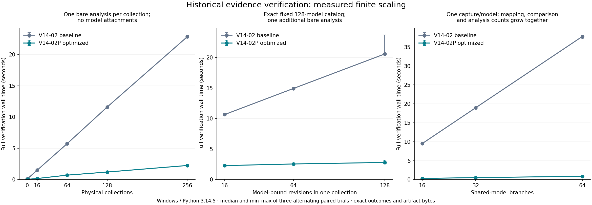

# V14-02P performance and security acceptance

This consolidated record preserves V14-02's original measurements and documents
an additive optimization of its historical consumer. Distribution remains
1.4.0.dev1; native engine semantics remain 1.3.0. No drift or historical Explorer
functionality is introduced. Final local installed-package and timing results are
recorded below. Hosted acceptance remains pending owner-controlled publication.

## Immutable reference and initial investigation

Starting checkpoint: `bc3ff41df4fd7c200ec659724aa8c928f549b443`, clean, on the
completed V14-02 branch. Tested implementation: `3724062639b63c0d37e4b29ea11eabbf25bc4f5f`.
The original branch, commits, benchmark implementation and receipts are preserved.
Optimization branch: `codex/v14-02p-history-performance-hardening`, branched from
that exact checkpoint rather than main or V14-01. Stable v1.3.0 still peels to
`10d7de6c416ec6f0ee364c671ebe9292ee69e672`.

Remote dependency refs were fetched. Draft #18 remains based on Draft #17,
with exact heads `bdf51dc54f991ab9edc1a09176b5e55b2ad0df6e` and
`3201f5d39db4c9bb4fbd565dd62fcc28145800b4`. All six V14-01 checks passed in
run 40417348042. No V14-02/V14-02P hosted result is inherited from that run;
no push, PR creation, merge, tag, workflow dispatch or publication is authorized.

Fresh pre-edit measurements used the original regular installed wheel against
the original 83-file / 721,436-byte workspace. Untraced verify trials were
6.194 / 6.260 / 5.982 s, median 6.194 s, median CPU 6.141 s. List collections
median was 3.146 s; list revisions median 2.938 s. These are fresh baseline
observations, separate from the prior checkpoint's traced and untraced receipts.
Raw initial receipt and cProfile: `output/v142p-baseline-profile/`.

Final runtime implementation freeze:
`4cb2da9b95fab48c9077696dfcde0ecc60e8adb9`. All controlled comparisons below
bind the original installed production inventory to `bc3ff41` and the optimized
inventory to this exact production commit. A later fixture-only correction
prepares a missing idempotent-reuse prerequisite using the original producer;
it changes no runtime module. Each receipt records its exact harness commit and
tool hashes separately. Later delivery edits change documentation and measurement
receipts only; source/package audits distinguish delivery from implementation.

Measured bottlenecks, not inferred solely from elapsed time:

| Work in one original full verification | Actual count |
|---|---:|
| Complete workspace acquisitions | 2 |
| Workspace object reads | 166, for 83 files |
| Snapshot validations | 160, for 16 snapshots |
| Attachment validations | 64, for 16 model attachments |
| Analytical revision validations | 64, for 32 analyses |
| Native model validations | 64, for 16 native models |
| Implementation inventories recomputed | 64 |
| Baseline validations / review resolutions | 18 / 3 |
| Logical file reads including implementation sources | 2,342 |
| Total bytes read including implementation sources | 20,513,144 |
| JSON parses / serializations | 838 / 105,621 |
| SHA-256 calls | 6,897 |

The count profile is heavily instrumented and does not establish end-user
latency. cProfile located native YAML parsing and oversized buffered reads as
material costs, alongside repeated defensive copies and schema/hash work.
This rejects the hypothesis that disk I/O alone explains the slowdown.

## Compatibility decision: preserve producer bytes

`evidence/attachments.py`, `evidence/revisions.py`, `evidence/workspace.py` and
`evidence/observations.py` participate in the frozen analytical semantics source
inventory. They remain byte-identical. Native parsing, enrichment, association,
comparison, policy and reachability sources also remain unchanged. No approved
analysis ID, producer manifest, snapshot, attachment, baseline or review changes.

The new optimized consumer is a separate implementation of the same checked
contract, using frozen helpers, constants and authoritative native validation.
Its complete implementation identity belongs in installed-module inventories
and execution receipts; it does not rewrite historical producer identities.
Differential tests compare exact bytes, IDs, manifests, joins, results, native
witnesses and diagnostics with the original installed distribution.

## Operation-private ownership and trust boundary

Every independent public lifecycle operation acquires a new complete workspace.
The acquisition checks every member, including unreferenced objects, and retains
parsed objects plus exact raw byte lengths and SHA-256 receipts. Raw input buffers
are released after decoding. The public state shape remains unchanged.

An internal validation context owns that acquisition for one invocation. It
validates each distinct dependency, reuses completed native model validation and
resolves reviews once for inspection. It never accepts a caller's validated flag,
file name, size, timestamp or self-reported digest as structural authority.
No persistent or module-global cache exists. Public returned dictionaries cannot
seed a later operation's validity. Standalone frozen validators still perform
their full independent checks.

Direct in-memory calls undergo a bounded values-only node/depth/type preflight
before copying. Per-object ASCII budgets remain unchanged. Aggregate estimates
for preserved snapshots use a conservative UTF-8 minimum because their accepted
raw storage may be compact/unescaped; new objects retain mandatory ASCII storage.
This does not replace the actual raw byte ceiling in acquisition/publication.
Escaped lone surrogates and canonical scalar/surrogate-pair equivalents retain
their frozen meanings; no text is normalized to make an input fit a budget.

New values are detached before they can interact with cached dependencies.
Prospective state uses copy-on-write membership maps; the acquisition still
describes the original committed files. Any failed validation poisons that
context. A failed write returns no successful approval or misleading partial
result. Cached successes never authorize another capture, observation, model,
mapping, semantics configuration or review scope.

Review and baseline builders retain the exact canonical fields. Private review
record construction is followed by complete prospective graph validation before
publication or result return. The public standalone review builder still checks
the complete graph itself. List summaries reuse the one resolved graph and a
bounded per-subject history index instead of resolving it once per baseline.
Terminal states, conflicts, predecessors, cycles and no carry-forward semantics
are unchanged. No current-baseline pointer is introduced.

## Filesystem and publication design

Reads request at most the checked open-file size plus one rejection sentinel,
subject to the unchanged maximum. They retain regular-file, inode/device, size,
mtime and same-API ctime comparisons, pre/post path checks, reparse/symlink
rejection and bounded decoding. A short or grown read fails safely. Windows
`lstat` and `fstat` ctime fields are never compared as if they had identical
semantics. Tiny inputs no longer request a 64-MiB temporary buffer.

Writes retain a second physical acquisition immediately before publication:
the complete bounded directory membership and each original member's exact
byte SHA are checked again. This is stronger than the old capacity-only reread;
it is not a stat-only freshness shortcut. It avoids repeated parsing/native
replay while preserving content freshness and exact raw-size accounting.
Atomic no-replace publication remains unchanged. Idempotent no-ops are fresh
validated reads and never overwrite existing objects.

The final path refinement is restricted to the pre/post checks inside historical
byte reads. One fresh non-following metadata record per ancestor supplies the
same link/reparse checks as the repeated original queries. There is no metadata
cache. Any observed unsafe component fails immediately; a later safe observation
cannot erase it. Reparse tags are interpreted only with the reparse attribute.
Custom Path implementations, replaced concrete-class or OS observers, unsupported
lexical paths and other filesystem errors delegate to the frozen path policy.
Observer guards compare exact function identity, including WindowsPath overrides.
Root/directory, migration and frozen publication checks retain their original
policy. Independent probes found and corrected prototype observer and unsafe-
retry counterexamples before integration. Forty-five dedicated product cases
cover these boundaries; a 292-case focused run passed on both Windows Python
versions. Existing real junctions and created file/directory/dangling symlinks
were inspected; creating a new junction was unavailable on this host. Helper-
only measurements reduced 30 metadata queries to 10 on a ten-component path,
with roughly 2.5–2.7x helper speedup. These are microbenchmarks, not end-to-end
claims. Probe receipts remain under `output/v142p-path-candidate-probe/`.

Migration still reopens and compares the source and destination bytes, preserves
original snapshots verbatim, and publishes the destination manifest last. No
physical migration integrity check was removed. Failure artifacts remain for
manual inspection, with no destructive recovery or automatic repair.

The existing local single-writer model remains. This is not OS sandboxing,
authenticated organizational authority or a privileged hostile-writer defense.

## Measurement method and reproducibility

The installed-worker harness is `benchmarks/history_performance.py` with
`tools/history_performance_worker.py`. It verifies each installed production
module against the declared Git commit before preparing fixtures; it also
records implementation identities after measured operations. Baseline builders
generate all synthetic cases. Each paired trial receives byte-identical copied
inputs, prepared outside the measured region. Original benchmark fixtures are
copied, never regenerated using optimized producer semantics.

Primary measurements use uninstrumented direct public APIs, independent operation
contexts and alternating baseline/optimized processes. Read-only timing has an
explicit warmup; mutation timing always starts from a fresh case. Console
measurements include cold process startup. Profiling and tracemalloc run in
separate modes and never supply primary speedup claims. Fresh-process RSS
includes interpreter/import cost; it is distinct from traced operation allocation.

Every comparison checks public outcomes, structured errors/exit codes and exact
persistent artifact byte manifests before accepting its timing samples. Raw
trials, medians, min/max, spread and median absolute deviation are retained.
An attractive timing with a differential mismatch is an automatic failure.

Workload names identify the base template. Mutation cases add the minimum
proposal/review prerequisites outside timing, so not every `original83` case has
exactly 83 files at its measured boundary; each case's full input manifest binds
its actual content. `review_state` measures generic inventory integrity followed
by the public pure review resolver, not complete analytical lifecycle validation.
`verify`, lifecycle listing/inspection and mutation retain their full documented
global analytical guarantee. The resolver timing must not be presented as a
replacement for full verification.
The `show_baseline_text` label denotes JSON baseline inspection through the direct
API and actual text rendering through the console; those two rows are separate
measurements, not identical presentation workloads. Fresh-write benchmarks require
`ADDED`, while reuse requires `ALREADY_PRESENT`, in API and console modes alike.

Host: Windows 11 AMD64, Intel Core i5-11400H @ 2.70 GHz. The pre-existing active
power plan was Maximum performance (`2d4d6631-5ed2-452e-9c1a-4df6b43ced8a`).
Primary before/after comparisons use the same Python 3.14.5 interpreter family
and pinned verification dependencies. Dedicated Windows Python 3.12.14 testing
uses the bundled runtime in an isolated regular environment. OS cache, antivirus
and scheduling noise are not forcibly controlled; raw spread is disclosed.
Heavy regression jobs do not run concurrently with final timing comparisons.

Independent collection, revision, review-depth, baseline-count, unreferenced-model
and metadata-size axes are generated by baseline code. Review depth varies with
both revision and baseline counts held fixed; baseline count varies at fixed
revision count; unreferenced model count does not add analytical revisions.
Case parameters and all input byte identities are retained. No linear-complexity
claim is inferred from a workload that changes more than one axis.

The pure revision axis selects 16/64/128 model-bound revisions from an identical
128-model catalog. The review-depth axis holds 64 revisions, 64 models and 64
proposals fixed while adding 16/32/64 review records. Baseline-count comparisons
include a separate zero-proposal case with that same 64-model catalog. The model
attachment axis retains identical snapshot/revision bytes and adds unreferenced
models, which remain subject to full verification. Shared-model fan-out uses
16/32/64 distinct reviewed mapping/comparison/revision branches over the same
committed fictional capture and exact model, with no approvals. Those three
branch counts co-vary and are explicitly reported as a coupled dependency
workload. The packet/metadata axis also changes observation cardinality; it does
not isolate JSON padding or claim a pure byte-size cost. Fixtures and input
manifests retain these parameters rather than labeling every workload by C alone.
Collection scaling retains one bare analytical revision per physical collection;
their total counts therefore grow together while revisions per collection stay
fixed. Pure revision scaling instead holds physical collection count at one.

One experimental aggregate preflight was rejected during independent audit:
ASCII-escaped estimates could overcharge valid compact UTF-8 snapshots. A real
21,881-byte accepted workspace reproduced the issue. The first comparison run
was intentionally stopped after eight paired rows; its incomplete data remains
under `output/v142p-primary/` with an interruption note and is not acceptance.
The conservative UTF-8 floor correction and four independent boundary proofs
passed on Windows Python 3.12.14 and 3.14.5 before restarting final comparisons.

A second incomplete comparison, `output/v142p-primary-final/`, was stopped after
28 paired rows to integrate the independently reviewed path refinement. Its
raw trials and interruption note remain available; it is also excluded from final
acceptance. Final comparisons use one frozen implementation for every row.

The first complete-matrix attempt on P7, `output/v142p-acceptance/`, stopped at
the dense idempotent-reuse case after 58 completed rows. Both implementations
created the requested model-only revision because that exact revision was absent
from this template. The expected-outcome guard rejected the benchmark rather than
accepting equal successful writes as evidence of reuse. The correction prepares
that exact prerequisite with the baseline producer before binding trial inputs;
a regression checks `ALREADY_PRESENT` and unchanged artifact bytes. The incomplete
run and its interruption note are retained and excluded from final acceptance.

Method references: [Python 3.14 profiling](https://docs.python.org/3.14/library/profile.html),
[allocation tracing](https://docs.python.org/3.14/library/tracemalloc.html),
[Python 3.12 pathlib](https://docs.python.org/3.12/library/pathlib.html) and
[Python 3.14 pathlib](https://docs.python.org/3.14/library/pathlib.html).
Local measurements and implementation inspection establish the reported causes;
documentation is not a substitute for running each interpreter.

## Independent adversarial review and rejected shortcuts

Six responsibilities were covered in coordinated waves with three subagents:
profiling/acceptance, filesystem/serialization, dependency validation, review
resolution, independent cache/security challenges and final source audit. The
integration owner reviewed their interfaces and retained one source freeze.

The audit challenged same-size/mtime replacement, content changed after an
earlier successful operation, rehashed foreign dependencies, altered mappings,
scope/approval confusion, invalid unreferenced objects, caller/return-value
aliasing, cache poisoning, native replay separation and exact error precedence.
I/O cases cover bounded sentinel reads, truncation/growth, identity replacement,
duplicate keys, nonregular paths, disk-full/interrupted publication and migration
source changes. Review cases retain conflict/fork/cycle/terminal-state rejection
and lack of approval carry-forward. A fresh operation always repeats required
native validation and replay.

The final read-only auditor checked all 20 directive questions against actual
source hashes and executed focused receipts. Source/security verdict: no
unresolved finding within the documented threat model. Full installed acceptance
and performance were explicitly left pending at that review, rather than inferred
from source inspection. Its original receipt is
`output/v142p-final-independent-audit.json`; final dispositions below add executed
package and measurement evidence without rewriting that earlier observation.

Rejected designs include stat-only freshness, persistent approval/data caches,
skipping unreferenced objects or native replay, changing producer source hashes,
removing the second physical publication check and trusting caller validity flags.
The aggregate-ASCII false rejection and concrete-observer prototype bypass were
actual counterexamples, corrected and preserved with regression tests. Repeated
snapshot validation at the storage/semantic boundary remains deliberately intact:
the private image contains mutable Python values, so skipping the consumer check
solely because acquisition checked them would require a different ownership proof.

## Small independent corpus maintenance

The existing local `cisa-opcua-gap` capture has exact SHA
`030950345b2c79eaf3bedf8a04c2325cfe4a5d8b40225d250ed693daf350b6b6`,
83,524 bytes and PCAPNG magic `0a0d0d0a`. Only its erroneous `capture_type` registry
field changes from `pcap` to `pcapng`. Original bytes, source identity, licensing
and redistribution restrictions remain unchanged. Corpus integrity verification
now succeeds; 55 corpus/external-tool tests pass. Receipt:
`output/v142p-corpus-correction.json`. No new decoder support or external capture
acquisition is part of this work.

## Reproduction commands

Use regular, noneditable installations with the pinned verification dependencies.
Keep the original environment and original benchmark receipts. The harness rejects
the wrong interpreter family or source inventory, changed inputs, unexpected
success/failure, and different public or persistent results. Choose fresh output
directories; the existing acceptance directories must be preserved. The original
83-file source can be reproduced with the unchanged `benchmarks/evidence_history.py`
on the original installation; the dense fictional source comes from the unchanged
`tools/evidence_history_walkthrough.py` producers. Their identities are recorded
in the comparison receipts. Synthetic scaling fixtures use only baseline builders.

The following PowerShell commands repeat the final measurement selection:

```powershell
$perfArgs = @(
  '--baseline-python', '.venv-v142-wheel/Scripts/python.exe',
  '--optimized-python', '.venv-v142p-wheel/Scripts/python.exe',
  '--baseline-commit', 'bc3ff41df4fd7c200ec659724aa8c928f549b443',
  '--optimized-commit', '4cb2da9b95fab48c9077696dfcde0ecc60e8adb9'
)
$fixtureArgs = @(
  '--reference-workspace', 'output/v142-history-benchmark-source/history',
  '--dense-workspace', 'output/v142-installed-history-walkthrough/first/history'
)
python -m benchmarks.history_performance @perfArgs @fixtureArgs --output output/reproduce-v142p-primary --scales --modes timing console --trials 3
python -m benchmarks.history_performance @perfArgs --output output/reproduce-v142p-scaling --dense-workspace output/v142-installed-history-walkthrough/first/history --scales 0 1 16 64 128 256 --fanout-scales 16 32 64 --operations verify list_collections list_revisions --axis-operations verify review_state --modes timing --trials 3
python -m benchmarks.history_performance @perfArgs @fixtureArgs --output output/reproduce-v142p-memory --scales --modes memory --trials 3
python -m benchmarks.history_performance @perfArgs @fixtureArgs --output output/reproduce-v142p-profile --scales --operations verify --modes profile --trials 1
```

Run these stages serially, before heavy regression suites. The parent interpreter
must have the verification dependencies and a regular installed application;
workers set offline Python hooks and isolated local temporary paths themselves.
For a new machine, rebuild/install from the declared immutable revisions and
retain the new environment and power-plan receipts rather than claiming the
same hardware/cache conditions.

## Final measured results and acceptance

Local verdict: **READY_WITH_NONBLOCKING_LIMITATIONS**, 2026-10-27.
Production source is exactly `4cb2da9b95fab48c9077696dfcde0ecc60e8adb9`;
the corrected measured harness is exactly
`c237f4e8c54ca08a040952e2b74ffd834bad567c`. The immutable baseline remains
`bc3ff41df4fd7c200ec659724aa8c928f549b443`. Every measured installed module
inventory matches its declared production commit. Dependency versions match in
the controlled baseline/optimized environments. Distribution/native versions
remain 1.4.0.dev1/1.3.0.

Six completed stages contain **280 comparisons / 1,740 measured workers**:
132 primary, 58 scaling, 69 memory, three profile, 12 Python 3.12, and six
initialization follow-up comparisons. Primary/scaling/memory/3.12 rows have three
alternating paired trials; profile rows have one separately instrumented trial;
initialization follow-up rows have nine. Six additional read-only cProfile passes
run inside the existing profile workers. All expected outcomes, exact public
digests, input identities and persistent artifact digests match. Fresh writes
actually return ADDED; reuse actually returns ALREADY_PRESENT. No incomplete run
contributes rows to these totals.

Original83 API verification: **5.708 [5.679–5.854] → 0.764 [0.738–0.785] s,
7.47x**. CPU median **5.703 → 0.766 s, −86.6%**. Cold installed console verify:
**6.191 → 1.588 s, 3.90x**. API attachment import improves 7.07x, revision creation
6.99x, proposal 9.27x, approval 9.47x, supersession/revocation 9.24x. These are
measured finite-workload gains, not universal speedup promises.

The separate memory verify case uses the exact same input identity: traced peak
**65.873 → 2.281 MiB (−96.54%)**; fresh-process lifetime RSS peak **108.730 →
44.660 MiB (−58.93%)**. Dense/workflow verification traced peaks are respectively
67,700,653 → 625,755 B and 67,518,467 → 475,071 B. Across all 69 memory rows,
67 traced medians decrease, two initialization rows tie, and none increase.
RSS and traced allocations are different measurements; neither is substituted
for the other or for the old benchmark process's historical high-water mark.

All raw timing/CPU/peak samples, medians, ranges, MAD, source identities and
normalized profile counters are preserved in the public
[machine-readable receipt](../../benchmarks/receipts/v14-02p-windows.json).
Full worker requests, outcomes, artifact trees and .prof/.txt files remain under
`output/v142p-verified-{primary,scaling,memory,profile,py312}/` and
`output/v142p-initialize-followup/`. The compact public receipt contains every
measured timing sample and source/outcome hashes, without raw third-party traffic
or personal absolute environment paths. Profiling and traced elapsed ratios in
raw data are diagnostic only; latency claims use timing/console rows exclusively.



The figure is generated from the receipt's untraced scaling medians and ranges
with Matplotlib 3.10.7 in an isolated optional development environment. It contains
no fit, confidence interval or extrapolated points. Matplotlib is not an application
dependency. Figure SHA and provenance are recorded in the public receipt.

### Growth actually observed

Collections C64/128/256: baseline verify 5.737/11.593/22.822 s; optimized
0.701/1.196/2.242 s. The optimized doubling ratios are 1.71x and 1.87x.
C256 has 513 files / 3,366,721 B, at the collection-count ceiling, with verify
range 22.720–23.025 → 2.219–2.320 s and lifetime RSS 112.14 → 48.75 MiB.
It does not test the 256-MiB byte ceiling. Collection and bare-analysis totals
grow together; analyses per collection stay fixed.

At one collection and an identical 128-model catalog, R16/64/128 verification
is 10.655/14.917/20.582 → 2.284/2.548/2.797 s. Only analysis files differ.
The R128 range is visibly wider; three trials do not support significance or a
general asymptotic claim. D0→64 at fixed models/revisions/proposals is
12.639→14.926 s baseline and 1.658→1.805 s optimized. B0→64 at fixed models and
revisions is 10.321→12.639 s and 1.495→1.658 s.

Unreferenced M16/64/128 models verify in 1.368/5.042/9.357 →
0.350/1.228/2.364 s. Their full native validation remains necessary. Shared-model
fan-out K16/32/64 verifies in 9.517/18.958/37.795 → 0.288/0.508/0.852 s,
33.0x/37.3x/44.3x. Capture/model bytes remain fixed while distinct mapping,
comparison and analysis counts grow together. Every scaling median and every
paired trial improves across all 58 rows. This demonstrates finite gains and
reduced repetition; it does not prove global linear complexity. Sorting,
canonicalization and frozen native algorithms retain their existing costs.
Independent mutations still perform fresh global validation, so a sequence of
growing writes retains cumulative work; no cross-operation cache is implied.

### Negative results and their disposition

Primary original83 initialization is slower: API 14.0777→14.7213 ms
(+0.6436 ms, +4.57%); cold console 886.3662→933.4142 ms
(+47.0480 ms, +5.31%). All three console pairs are slower. Other two primary
initialization cohorts have faster medians. The nine-trial follow-up retains:

| Follow-up cohort | Median change | Paired signs |
|---|---:|---|
| Original83 API | +0.3011 ms | 6 slower / 3 faster |
| Original83 console | −13.6498 ms | 3 slower / 6 faster |
| Dense console | +4.6622 ms | 4 slower / 5 faster |
| Workflow console | +9.0536 ms | 5 slower / 4 faster |

The earlier +47-ms direction does not repeat for the same console cohort. Both
studies and every sample remain recorded. No causal or insignificance conclusion
is inferred merely from overlapping ranges or unchanged initializer/helper ASTs.
The initialization function, reservation helper and limits have unchanged ASTs;
cold imports are outside that proof. These small startup variations remain a
nonblocking limitation, not an erased negative finding. Across 208 untraced rows,
194 improve in every pair; five slower medians are all initialization rows in
these two separately reported studies.

The only higher RSS median is original83 initialization: 40,566,784 →
40,656,896 B, **+88 KiB / +0.222%**, all three pairs higher. Baseline range is
40,456,192–40,579,072 B; optimized range 40,652,800–40,767,488 B. This observation
is retained without attributing it to a particular cause or calling it noise.
All other memory-stage RSS medians decrease. No correctness, integrity or
security regression remains unresolved. Small startup/RSS costs are distinct
from the substantial gains in actual historical processing.

### Profile interpretation

Original83 complete acquisitions fall 2→1; attachment validation bodies 64→16;
revision bodies 64→32; snapshots 160→32; native models 64→16; source inventories
64→1. The same 16 snapshots, 16 attachments, 32 analyses, nine baselines and nine
reviews remain checked. Logical reads 2,342→117 and bytes 20,513,144→1,019,409
include implementation-source reads. JSON parses 838→211, serializations
105,621→16,397, SHA calls 6,897→1,040 and clone round trips 448→80.

Dense validation retains every object and all four revisions. Native validation
executions fall 28→1, comparison replays 4→1, attachment bodies 36→4 and snapshot
calls 48→4. One mapping and one comparison complete validation; the frozen
reviewed-mapping function still executes twice, including native replay's own
check, versus 12 previously. Three native-cache lookups are not three native
validations. A vanished standalone function name does not mean a skipped check:
the replacement context's completed bodies and identities are counted explicitly.
Complete acquisitions are not a claim of one underlying OS directory enumeration.

Remaining costs include actual byte acquisition and hashing, canonical envelopes,
defensive snapshot validation at the storage/semantic ownership boundary, one
native parse per distinct model input and one required replay per distinct
comparison. No persistent data/authority cache, native-semantic shortcut or
unchecked presentation API is introduced. Frozen standalone v1 producer/storage
implementations remain intact; this milestone's consumer acceleration does not
claim to rewrite their standalone command costs.

## Final independent acceptance and packages

Three complete offline regular-install suites have identical sets of **3,764
unique tests**, all passing with **zero failures/errors/skips**: Windows 3.14.5
wheel, Windows 3.14.5 separately built/installed sdist, and Windows 3.12.14 wheel.
Every one of the original 3,573 identities remains; 191 cases are added.
Overlapping focused/adversarial runs are not added to this unique count.

| Executed gate | Result | Local receipt under output/ |
|---|---|---|
| Installed 3.14 wheel full suite | 3,764 PASS; 720.12 s | v142p-full-wheel.xml / .log |
| Installed 3.14 sdist full suite | 3,764 PASS; 707.29 s | v142p-full-sdist.xml / .log |
| Installed 3.12 wheel full suite | 3,764 PASS; 704.70 s | v142p-full312.xml / .log |
| Test identity set equality and preservation | 3,764 identical; all 3,573 retained | v142p-full-suite-summary.json |
| Ruff lint / formatting / strict mypy | PASS; 329 formatted files / 217 checked files | v142p-delivery-ruff-check.log, v142p-delivery-ruff-format.log, v142p-delivery-mypy.log |
| Dependency and regular installed-source checks | PASS in all three tested environments | v142p-full*-pipcheck.log / -environment.json |
| Immutable native compatibility | PASS; 124 captured artifacts under established allowlist | v142p-native-compatibility/comparison.json |
| Frozen supported / limited readers | both PASS | v142p-reader-supported.json / v142p-reader-limited.json |
| Installed history walkthrough, two runs | PASS; identical canonical IDs | v142p-installed-history-walkthrough/walkthrough.json |
| Evidence/project/Explorer/document/quality/capture walkthroughs | all PASS | v142p-*-walkthrough/walkthrough.json |
| Existing examples | 31 installed CLI commands validated; runner exit 0 | v142p-examples.log |
| Corpus metadata correction | PASS; original capture hash preserved | v142p-corpus-correction.json |
| Full measured source/archive inventory | PASS; 423 public files at c237f4e | v142p-measured-source-checkout.json / -archive-audit.json |
| Final delivery source/archive inventory | 426 public files; exact source and members checked after commit | v142p-delivery-source-checkout.json / -archive-audit.json |
| Documentation-only delivery parity | runtime/tests/fixtures/tools and all wheel member bytes preserved | v142p-delivery-parity.json |

The final documentation/data/chart delivery is audited after its local commit.
Its installed module inventory must still match the tested production bytes;
source/archive receipts identify that exact delivery commit. The default project
environment is restored to the optimized audited wheel; the original baseline
environment and every original receipt remain preserved. No third-party raw
capture is added to distributions. The CI matrix remains Windows/Ubuntu/macOS ×
Python 3.12/3.14. Local Windows execution does not establish the six hosted jobs.

The final roll-up auditor re-parsed all three suites and checked all 20 questions.
That auditor authored the context implementation, so its source self-review is
not presented as independent cache testing: a different author performed the
adversarial cache campaign, and the graph author independently reviewed I/O.
The integration owner inspected both and retained the exact tested source freeze.
Original pending source review and final acceptance review are separate receipts:
`v142p-final-independent-audit.json` and `v142p-final-acceptance-audit.json`.

| Directive audit question | Final disposition |
|---|---|
| 1. Existing functionality retained? | All 3,573 original test identities retained and passing; full workflows pass. |
| 2. Validation weakened? | No finding; full graph, structural/hash/identity and native checks retained. |
| 3. Artifact identities changed? | Exact paired outcomes/artifact bytes and frozen producer bytes match. |
| 4. Malformed data newly accepted? | Expected rejection guards, prior suites and independent attacks pass. |
| 5. Stale cache across operations? | No persistent validation/data cache; each invocation reacquires and validates. |
| 6. Recomputed digest bypass? | Foreign dependencies, capture/model/mapping and forged review joins rejected. |
| 7. Deterministic decisions? | Same scoped predecessor/conflict/terminal-state resolver; no clock authority. |
| 8. New revision automatically approved? | No; exact new subject remains unapproved. |
| 9. Non-destructive migration? | Exact source/snapshot byte checks and final-manifest publication retained. |
| 10. Atomic non-overwrite writes? | Frozen publication helper; fresh exact-byte prepublication check. |
| 11. Windows protections? | Actual Windows 3.12/3.14 focused and full acceptance; link/reparse guards retained. |
| 12. Resource bounds? | Unchanged ceilings, bounded preflight/caches, byte-sentinel reads; UTF-8 boundary corrected. |
| 13. Independent consumers? | Frozen readers and native compatibility pass. |
| 14. Wheel/sdist parity? | Same 3,764 test identities pass in regular installed environments. |
| 15. Actual executed measurements? | Raw trials/audits: 280 comparisons / 1,740 workers; incomplete runs excluded. |
| 16. Comparable conditions? | Exact paired inputs/sources, matching versions, alternating workers; environment limits disclosed. |
| 17. Instrumentation exaggeration? | Timing, cold console, tracing and profiling are separate modes. |
| 18. Negative results disclosed? | Five slower initialization medians across two studies and +88-KiB RSS retained. |
| 19. Supported finite scaling? | 25 workloads, C256 count boundary, R/D/B/M/metadata/fan-out; no byte-capacity guarantee. |
| 20. V14-03 foundation? | Validated public boundaries and bounded operation-private reuse are ready locally, with explicit limits. |

Limits remain: one local writer, trusted installed code, unauthenticated human
assertions, no capture-authenticity proof, finite generated workspaces, and no
Linux/macOS execution or hosted V14-02P CI claim. Creating a new Windows junction
was unavailable; actual existing junctions and created symbolic links were checked,
with other reparse fields exercised by controlled metadata cases. Limits are work
ceilings, not throughput promises. Future drift must define coverage comparability
and analytical meaning independently; no drift or historical Explorer is added.

Local decision: **READY_WITH_NONBLOCKING_LIMITATIONS**. Owner-controlled publication
and six successful hosted jobs on the exact published head are required before
remote acceptance. No push, PR, tag, merge, workflow dispatch or release was made.

## Complete operation tables

All times below are seconds, median [minimum–maximum]. CPU change uses untraced
API CPU medians; ratios are omitted if either median is below 31.25 ms. Windows
short-sample CPU accounting cannot support a useful percentage there. Raw CPU
values remain in the receipt. Traced peaks are separate exact-input memory rows,
in MiB (2^20 bytes), rounded for display. Expected-rejection labels mean the input
was rejected correctly, not accepted. JSON inspection and console text rendering
under show_baseline_text have the distinction described above.

### Public API: original83

| Operation | Baseline seconds, median [min–max] | Optimized seconds, median [min–max] | Speedup | CPU change | Traced peak MiB, old→new | Integrity |
|---|---:|---:|---:|---:|---:|---|
| initialize | 0.014 [0.012–0.015] | 0.015 [0.014–0.015] | 0.96x | short CPU sample | 0.14→0.14 | exact PASS |
| migrate | 2.032 [2.017–2.185] | 0.872 [0.813–0.878] | 2.33x | -61.7% | 65.43→1.51 | exact PASS |
| list_collections | 2.830 [2.799–2.904] | 0.735 [0.698–0.778] | 3.85x | -74.9% | 65.76→2.28 | exact PASS |
| list_revisions | 3.003 [2.901–3.025] | 0.730 [0.708–0.741] | 4.12x | -75.8% | 65.76→2.28 | exact PASS |
| show_revision | 2.906 [2.898–2.910] | 0.736 [0.734–0.742] | 3.95x | -74.7% | 65.76→2.28 | exact PASS |
| import_attachment | 7.969 [7.682–7.997] | 1.126 [1.086–1.149] | 7.07x | -86.1% | 67.47→2.44 | exact PASS |
| create_revision | 7.690 [7.652–7.916] | 1.100 [1.089–1.116] | 6.99x | -85.9% | 67.47→2.41 | exact PASS |
| reuse_revision | 6.042 [5.996–6.047] | 0.865 [0.825–0.938] | 6.98x | -85.6% | 67.47→2.28 | exact PASS |
| propose_baseline | 10.791 [10.741–11.074] | 1.164 [1.069–1.207] | 9.27x | -89.2% | 67.45→2.37 | exact PASS |
| approve | 9.708 [9.706–9.831] | 1.025 [1.022–1.046] | 9.47x | -89.5% | 67.45→2.37 | exact PASS |
| reject | 9.795 [9.760–10.000] | 1.012 [0.999–1.017] | 9.68x | -89.6% | 67.45→2.37 | exact PASS |
| supersede | 10.031 [9.749–10.069] | 1.086 [1.059–1.094] | 9.24x | -89.2% | 67.46→2.38 | exact PASS |
| revoke | 9.965 [9.928–9.998] | 1.078 [1.036–1.116] | 9.24x | -89.3% | 67.46→2.37 | exact PASS |
| list_baselines | 2.627 [2.626–2.638] | 0.734 [0.708–0.738] | 3.58x | -72.6% | 65.76→2.28 | exact PASS |
| review_state | 1.753 [1.711–2.044] | 0.405 [0.378–0.417] | 4.33x | -76.6% | 65.77→1.80 | exact PASS |
| show_baseline_text | 2.848 [2.843–2.865] | 0.749 [0.740–0.756] | 3.80x | -73.5% | 65.77→2.29 | exact PASS |
| verify | 5.708 [5.679–5.854] | 0.764 [0.738–0.785] | 7.47x | -86.6% | 65.87→2.28 | exact PASS |
| invalid_reference | 2.607 [2.581–2.664] | 0.726 [0.689–0.776] | 3.59x | -72.5% | 65.84→2.29 | expected rejection; exact PASS |
| corrupt_json | 0.041 [0.041–0.041] | 0.011 [0.011–0.012] | 3.72x | short CPU sample | 64.21→0.21 | expected rejection; exact PASS |
| tampered_object | 2.208 [2.206–2.221] | 0.672 [0.668–0.686] | 3.29x | -69.7% | 65.76→2.28 | expected rejection; exact PASS |
| unsupported_version | 0.022 [0.021–0.024] | 0.006 [0.005–0.007] | 3.64x | short CPU sample | 64.15→0.16 | expected rejection; exact PASS |
| resource_exhaustion | 0.719 [0.711–0.773] | 0.181 [0.180–0.190] | 3.98x | -73.9% | 65.22→1.24 | expected rejection; exact PASS |
| conflict_approval | 2.848 [2.814–2.941] | 0.729 [0.727–0.816] | 3.91x | -74.0% | 65.78→2.29 | expected rejection; exact PASS |

### Public API: dense-native-replay

| Operation | Baseline seconds, median [min–max] | Optimized seconds, median [min–max] | Speedup | CPU change | Traced peak MiB, old→new | Integrity |
|---|---:|---:|---:|---:|---:|---|
| initialize | 0.014 [0.013–0.015] | 0.013 [0.012–0.014] | 1.03x | short CPU sample | 0.14→0.14 | exact PASS |
| migrate | 0.322 [0.302–0.342] | 0.155 [0.139–0.160] | 2.08x | -55.0% | 64.32→0.42 | exact PASS |
| list_collections | 0.665 [0.641–0.711] | 0.112 [0.106–0.118] | 5.95x | -83.3% | 64.39→0.60 | exact PASS |
| list_revisions | 0.673 [0.650–0.708] | 0.114 [0.108–0.117] | 5.92x | -83.7% | 64.39→0.60 | exact PASS |
| show_revision | 0.670 [0.655–0.706] | 0.112 [0.112–0.119] | 5.96x | -83.7% | 64.39→0.60 | exact PASS |
| import_attachment | 1.747 [1.716–1.762] | 0.211 [0.207–0.221] | 8.28x | -88.4% | 64.83→0.73 | exact PASS |
| create_revision | 1.767 [1.765–1.770] | 0.184 [0.180–0.189] | 9.62x | -89.3% | 64.83→0.69 | exact PASS |
| reuse_revision | 1.502 [1.485–1.525] | 0.132 [0.117–0.151] | 11.41x | -90.6% | 64.85→0.61 | exact PASS |
| propose_baseline | 2.498 [2.376–2.503] | 0.176 [0.173–0.184] | 14.18x | -93.1% | 64.80→0.65 | exact PASS |
| approve | 2.473 [2.455–2.521] | 0.182 [0.179–0.212] | 13.55x | -92.5% | 64.81→0.65 | exact PASS |
| reject | 2.441 [2.440–2.499] | 0.181 [0.181–0.188] | 13.49x | -92.3% | 64.81→0.65 | exact PASS |
| supersede | 2.587 [2.578–2.616] | 0.189 [0.187–0.197] | 13.67x | -92.7% | 64.82→0.65 | exact PASS |
| revoke | 2.522 [2.521–2.585] | 0.189 [0.184–0.194] | 13.36x | -93.1% | 64.81→0.65 | exact PASS |
| list_baselines | 0.668 [0.654–0.693] | 0.111 [0.103–0.114] | 6.01x | -83.3% | 64.39→0.60 | exact PASS |
| review_state | 0.417 [0.408–0.427] | 0.068 [0.068–0.072] | 6.15x | -85.2% | 64.39→0.40 | exact PASS |
| show_baseline_text | 0.660 [0.649–0.722] | 0.109 [0.108–0.116] | 6.04x | -85.7% | 64.39→0.60 | exact PASS |
| verify | 1.309 [1.276–1.330] | 0.104 [0.100–0.113] | 12.64x | -91.7% | 64.56→0.60 | exact PASS |
| invalid_reference | 0.693 [0.648–0.709] | 0.115 [0.106–0.119] | 6.04x | -84.4% | 64.56→0.60 | expected rejection; exact PASS |
| corrupt_json | 0.047 [0.039–0.055] | 0.010 [0.009–0.011] | 4.68x | short CPU sample | 64.16→0.16 | expected rejection; exact PASS |
| tampered_object | 0.529 [0.488–0.539] | 0.094 [0.088–0.102] | 5.64x | -82.4% | 64.39→0.47 | expected rejection; exact PASS |
| unsupported_version | 0.022 [0.019–0.023] | 0.006 [0.005–0.006] | 3.66x | short CPU sample | 64.15→0.15 | expected rejection; exact PASS |
| resource_exhaustion | 0.171 [0.160–0.173] | 0.036 [0.035–0.042] | 4.79x | -81.8% | 64.30→0.31 | expected rejection; exact PASS |
| conflict_approval | 0.712 [0.697–0.808] | 0.123 [0.122–0.137] | 5.79x | -82.2% | 64.40→0.61 | expected rejection; exact PASS |

### Public API: workflow

| Operation | Baseline seconds, median [min–max] | Optimized seconds, median [min–max] | Speedup | CPU change | Traced peak MiB, old→new | Integrity |
|---|---:|---:|---:|---:|---:|---|
| initialize | 0.013 [0.013–0.014] | 0.013 [0.012–0.013] | 1.02x | short CPU sample | 0.14→0.14 | exact PASS |
| migrate | 0.288 [0.281–0.307] | 0.120 [0.104–0.120] | 2.41x | -58.8% | 64.23→0.24 | exact PASS |
| list_collections | 0.309 [0.295–0.313] | 0.082 [0.082–0.088] | 3.75x | -68.4% | 64.28→0.45 | exact PASS |
| list_revisions | 0.315 [0.299–0.325] | 0.088 [0.083–0.097] | 3.57x | -70.0% | 64.28→0.45 | exact PASS |
| show_revision | 0.312 [0.300–0.312] | 0.092 [0.084–0.097] | 3.38x | -70.0% | 64.28→0.45 | exact PASS |
| import_attachment | 0.865 [0.841–0.869] | 0.168 [0.165–0.182] | 5.14x | -80.0% | 64.56→0.55 | exact PASS |
| create_revision | 0.862 [0.844–0.895] | 0.145 [0.143–0.161] | 5.96x | -83.9% | 64.56→0.52 | exact PASS |
| reuse_revision | 0.648 [0.610–0.673] | 0.100 [0.096–0.102] | 6.49x | -82.9% | 64.55→0.45 | exact PASS |
| propose_baseline | 1.169 [1.156–1.172] | 0.151 [0.136–0.158] | 7.76x | -86.1% | 64.53→0.48 | exact PASS |
| approve | 1.220 [1.215–1.223] | 0.141 [0.138–0.161] | 8.67x | -88.3% | 64.54→0.48 | exact PASS |
| reject | 1.226 [1.201–1.311] | 0.162 [0.150–0.175] | 7.58x | -88.5% | 64.54→0.48 | exact PASS |
| supersede | 1.365 [1.357–1.400] | 0.176 [0.168–0.185] | 7.78x | -87.4% | 64.55→0.49 | exact PASS |
| revoke | 1.326 [1.322–1.336] | 0.161 [0.149–0.169] | 8.23x | -88.1% | 64.54→0.48 | exact PASS |
| list_baselines | 0.303 [0.284–0.317] | 0.083 [0.082–0.094] | 3.65x | -73.7% | 64.28→0.45 | exact PASS |
| review_state | 0.200 [0.195–0.227] | 0.048 [0.043–0.049] | 4.15x | -76.9% | 64.29→0.30 | exact PASS |
| show_baseline_text | 0.370 [0.309–0.373] | 0.089 [0.085–0.094] | 4.17x | -75.0% | 64.29→0.46 | exact PASS |
| verify | 0.630 [0.604–0.645] | 0.090 [0.085–0.096] | 6.99x | -87.5% | 64.39→0.45 | exact PASS |
| invalid_reference | 0.340 [0.336–0.342] | 0.086 [0.083–0.087] | 3.96x | -72.7% | 64.39→0.45 | expected rejection; exact PASS |
| corrupt_json | 0.040 [0.038–0.046] | 0.010 [0.010–0.012] | 3.89x | short CPU sample | 64.16→0.16 | expected rejection; exact PASS |
| tampered_object | 0.232 [0.217–0.247] | 0.086 [0.071–0.090] | 2.71x | -66.7% | 64.28→0.31 | expected rejection; exact PASS |
| unsupported_version | 0.021 [0.021–0.022] | 0.005 [0.004–0.005] | 4.33x | short CPU sample | 64.15→0.15 | expected rejection; exact PASS |
| resource_exhaustion | 0.110 [0.098–0.115] | 0.026 [0.024–0.027] | 4.21x | -71.4% | 64.21→0.22 | expected rejection; exact PASS |
| conflict_approval | 0.355 [0.345–0.400] | 0.109 [0.102–0.127] | 3.25x | -69.6% | 64.30→0.47 | expected rejection; exact PASS |

### Cold installed console: original83

| Operation | Baseline seconds, median [min–max] | Optimized seconds, median [min–max] | Speedup | Integrity |
|---|---:|---:|---:|---|
| initialize | 0.886 [0.825–0.926] | 0.933 [0.923–0.965] | 0.95x | exact PASS |
| migrate | 2.824 [2.800–2.885] | 1.749 [1.646–1.776] | 1.61x | exact PASS |
| list_collections | 3.706 [3.691–3.725] | 1.544 [1.491–1.575] | 2.40x | exact PASS |
| list_revisions | 3.863 [3.851–3.975] | 1.614 [1.608–1.679] | 2.39x | exact PASS |
| show_revision | 3.915 [3.901–3.992] | 1.640 [1.640–1.660] | 2.39x | exact PASS |
| import_attachment | 8.641 [8.443–8.670] | 1.965 [1.938–2.012] | 4.40x | exact PASS |
| create_revision | 8.743 [8.487–8.786] | 1.934 [1.880–1.961] | 4.52x | exact PASS |
| reuse_revision | 6.869 [6.740–7.111] | 1.650 [1.610–1.701] | 4.16x | exact PASS |
| propose_baseline | 10.856 [10.425–11.265] | 1.739 [1.698–1.888] | 6.24x | exact PASS |
| approve | 10.735 [10.504–11.241] | 1.731 [1.704–1.814] | 6.20x | exact PASS |
| reject | 10.479 [10.351–10.574] | 1.763 [1.712–1.790] | 5.94x | exact PASS |
| supersede | 10.458 [10.405–10.535] | 1.719 [1.716–1.757] | 6.08x | exact PASS |
| revoke | 10.557 [10.527–10.914] | 1.723 [1.720–1.727] | 6.13x | exact PASS |
| list_baselines | 3.503 [3.499–3.564] | 1.494 [1.490–1.516] | 2.34x | exact PASS |
| show_baseline_text | 3.848 [3.761–3.903] | 1.611 [1.590–1.665] | 2.39x | exact PASS |
| verify | 6.191 [6.039–6.636] | 1.588 [1.483–1.660] | 3.90x | exact PASS |
| invalid_reference | 3.420 [3.392–3.449] | 1.443 [1.442–1.538] | 2.37x | expected rejection; exact PASS |
| corrupt_json | 0.790 [0.774–0.802] | 0.761 [0.761–0.779] | 1.04x | expected rejection; exact PASS |
| tampered_object | 3.044 [3.034–3.108] | 1.416 [1.409–1.426] | 2.15x | expected rejection; exact PASS |
| unsupported_version | 0.749 [0.742–0.767] | 0.746 [0.724–0.759] | 1.00x | expected rejection; exact PASS |
| conflict_approval | 3.475 [3.465–3.582] | 1.462 [1.406–1.538] | 2.38x | expected rejection; exact PASS |

### Scaling: full verification

| Workload | Files / bytes | Baseline median s | Optimized median s | Speedup |
|---|---:|---:|---:|---:|
| dense-native-replay | 17 / 102,226 | 1.297 | 0.101 | 12.84x |
| collections-0 | 1 / 175 | 0.063 | 0.018 | 3.51x |
| collections-1 | 3 / 13,324 | 0.163 | 0.036 | 4.53x |
| collections-16 | 33 / 210,565 | 1.493 | 0.161 | 9.30x |
| collections-64 | 129 / 841,765 | 5.737 | 0.701 | 8.19x |
| collections-128 | 257 / 1,683,393 | 11.593 | 1.196 | 9.69x |
| collections-256 | 513 / 3,366,721 | 22.822 | 2.242 | 10.18x |
| axis-r16-d0-b0-m0-p1-c128 | 147 / 824,590 | 10.655 | 2.284 | 4.66x |
| axis-r64-d0-b0-m0-p1-c128 | 195 / 1,148,638 | 14.917 | 2.548 | 5.85x |
| axis-r128-d0-b0-m0-p1-c128 | 259 / 1,580,702 | 20.582 | 2.797 | 7.36x |
| axis-r64-d16-b64-m0-p1-c64 | 211 / 890,251 | 13.181 | 1.710 | 7.71x |
| axis-r64-d32-b64-m0-p1-c64 | 227 / 906,715 | 13.753 | 1.744 | 7.88x |
| axis-r64-d64-b64-m0-p1-c64 | 259 / 939,643 | 14.926 | 1.805 | 8.27x |
| axis-r64-d0-b0-m0-p1-c64 | 131 / 796,994 | 10.321 | 1.495 | 6.90x |
| axis-r64-d0-b16-m0-p1-c64 | 147 / 816,210 | 10.952 | 1.532 | 7.15x |
| axis-r64-d0-b32-m0-p1-c64 | 163 / 835,426 | 11.445 | 1.587 | 7.21x |
| axis-r64-d0-b64-m0-p1-c64 | 195 / 873,858 | 12.639 | 1.658 | 7.62x |
| axis-r0-d0-b0-m16-p1-c0 | 19 / 101,426 | 1.368 | 0.350 | 3.90x |
| axis-r0-d0-b0-m64-p1-c0 | 67 / 365,762 | 5.042 | 1.228 | 4.11x |
| axis-r0-d0-b0-m128-p1-c0 | 131 / 718,238 | 9.357 | 2.364 | 3.96x |
| axis-r0-d0-b0-m0-p64-c0 | 3 / 216,931 | 0.283 | 0.090 | 3.16x |
| axis-fanout-16 | 52 / 317,923 | 9.517 | 0.288 | 32.99x |
| axis-fanout-32 | 100 / 612,787 | 18.958 | 0.508 | 37.34x |
| axis-fanout-64 | 196 / 1,202,515 | 37.795 | 0.852 | 44.34x |
| workflow | 9 / 50,961 | 0.637 | 0.092 | 6.93x |

### Original83 full verification profile

| Counter | Baseline | Optimized |
|---|---:|---:|
| history_inventory_passes | 2 | 1 |
| snapshot_validation_calls | 160 | 32 |
| attachment_validation_body_executions | 64 | 16 |
| revision_validation_body_executions | 64 | 32 |
| native_model_validation_executions | 64 | 16 |
| implementation_identities | 64 | 1 |
| file_reads | 2,342 | 117 |
| bytes_read | 20,513,144 | 1,019,409 |
| json_parses | 838 | 211 |
| json_serializations | 105,621 | 16,397 |
| sha256_calculations | 6,897 | 1,040 |
| canonical | 640 | 256 |
| digest | 4,433 | 811 |
| object_digest | 192 | 80 |
| _clone | 448 | 80 |
| validate_baseline | 18 | 9 |
| validate_reviews | 3 | 1 |

### Fresh-process memory: original83

| Operation | Traced peak MiB, old→new | Lifetime peak RSS MiB, old→new |
|---|---:|---:|
| initialize | 0.14→0.14 | 38.69→38.77 |
| migrate | 65.43→1.51 | 105.48→42.51 |
| list_collections | 65.76→2.28 | 106.63→44.70 |
| list_revisions | 65.76→2.28 | 106.57→44.55 |
| show_revision | 65.76→2.28 | 106.71→44.61 |
| import_attachment | 67.47→2.44 | 112.70→45.39 |
| create_revision | 67.47→2.41 | 112.64→44.90 |
| reuse_revision | 67.47→2.28 | 112.23→44.79 |
| propose_baseline | 67.45→2.37 | 112.84→44.94 |
| approve | 67.45→2.37 | 112.84→45.09 |
| reject | 67.45→2.37 | 112.57→44.99 |
| supersede | 67.46→2.38 | 112.57→44.75 |
| revoke | 67.46→2.37 | 112.82→44.64 |
| list_baselines | 65.76→2.28 | 106.44→44.79 |
| review_state | 65.77→1.80 | 106.60→43.21 |
| show_baseline_text | 65.77→2.29 | 106.46→44.97 |
| verify | 65.87→2.28 | 108.73→44.66 |
| invalid_reference | 65.84→2.29 | 108.23→44.96 |
| corrupt_json | 64.21→0.21 | 102.58→39.08 |
| tampered_object | 65.76→2.28 | 106.68→44.96 |
| unsupported_version | 64.15→0.16 | 102.43→39.05 |
| resource_exhaustion | 65.22→1.24 | 105.22→41.55 |
| conflict_approval | 65.78→2.29 | 106.73→44.70 |

### Separate Windows Python 3.12 paired measurements: original83

| Operation / mode | Baseline seconds, median [min–max] | Optimized seconds, median [min–max] | Speedup |
|---|---:|---:|---:|
| verify / timing | 5.624 [5.603–5.650] | 0.784 [0.751–0.788] | 7.17x |
| verify / console | 6.432 [6.404–6.493] | 1.449 [1.440–1.504] | 4.44x |
| create_revision / timing | 7.438 [7.420–7.540] | 1.075 [1.062–1.131] | 6.92x |
| create_revision / console | 8.109 [8.004–8.138] | 1.654 [1.648–1.667] | 4.90x |
| propose_baseline / timing | 10.199 [10.105–10.504] | 1.083 [1.072–1.120] | 9.42x |
| propose_baseline / console | 10.766 [10.729–10.822] | 1.688 [1.665–1.689] | 6.38x |

### Initialization follow-up: nine fresh paired trials per row

| Base template / mode | Baseline seconds, median [min–max] | Optimized seconds, median [min–max] | Speedup |
|---|---:|---:|---:|
| original83 / timing | 0.013 [0.012–0.016] | 0.013 [0.013–0.014] | 0.98x |
| original83 / console | 0.712 [0.674–0.801] | 0.699 [0.680–0.764] | 1.02x |
| dense-native-replay / timing | 0.014 [0.013–0.015] | 0.013 [0.012–0.014] | 1.10x |
| dense-native-replay / console | 0.694 [0.670–0.763] | 0.699 [0.676–0.714] | 0.99x |
| workflow / timing | 0.013 [0.012–0.015] | 0.013 [0.012–0.014] | 1.04x |
| workflow / console | 0.701 [0.670–0.799] | 0.710 [0.682–0.753] | 0.99x |
