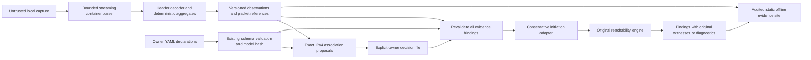

# PCAP Evidence Studio — development candidate

PCAP Evidence Studio reads local fictional or authorized PCAP evidence without
initiating network communications. It answers what was observed, which owner-reviewed
identities and declarations can be compared, and which uncertainties need review.
Observed traffic is not permission. Unobserved traffic is not evidence of blocking.

This is additive v1.3 development on the v1.2 baseline. Native YAML remains schema 1.
The package/engine version remains 1.2.0 to preserve frozen historical contracts
until a separately reviewed version transition. Capture, observation, association,
comparison, protocol catalog and site contracts each start at version 1.
No stable v1.3 release or human acceptance is claimed.

## Operation and definitive CLI contract

Run a regular installed `otarchguard` console:

```text
otarchguard capture inspect "plant.pcapng"
otarchguard capture analyze "plant.pcapng" --output "observed evidence"
otarchguard capture map "plant.pcapng" --model architecture.yaml --output pending.json
otarchguard capture compare "plant.pcapng" --model architecture.yaml --mapping reviewed.json --output comparison
```

`inspect` validates the entire container, hashes its exact bytes, reports interfaces,
packet counts, omitted block types, limits and compatibility; it does not evaluate
a model. `analyze` additionally decodes headers, aggregates records and creates
`observations.json` and a local multipage HTML/CSS/SVG site.
`map` writes only a decision template. `compare` reparses the capture, validates
the native model and every evidence binding, evaluates eligible observations
through the original engine, and publishes observations, comparison, reviewed
mapping JSON and the evidence site. It never edits the model.

All four commands print deterministic JSON to stdout. Diagnostics are JSON objects
on stderr. Exit **0** means a complete supported operation, including unreachable
results, discrepancies, pending mappings and explicitly unsupported observations.
Exit **2** means invalid input, incompatible container, exceeded resources or an
operational failure. No successful partial report is published. Exit **1** remains
reserved for historical failed-declared-intent commands, not capture findings.
Use `capture --help` or a subcommand's `--help` for options. Destinations must be
fresh, with an existing local parent; existing files/directories are preserved.
Quoted paths containing spaces are supported. Links, junctions, UNC/network paths,
device output names and alternate data streams are rejected.

## Data flow and trust boundaries



Parser bytes are transient. Aggregates contain metadata, not packet payloads.
Mapping decisions assert identity within this finite evidence; a digest is not an
identity signature. Engine witnesses are routes supported by the declared model;
they are not routes proved to have carried the captured packet. No observed link
is automatically a physical adjacency or an authorized communication.

## Supported subset and coverage

| Layer or format | Implemented scope | Explicit boundary |
| --- | --- | --- |
| Classic PCAP | 2.4, both byte orders, micro/nanoseconds, exact fractional timestamps | Reserved/extended linktype/FCS flag variants rejected; no modified vendor formats |
| PCAPNG | Section/interface/enhanced/simple packet blocks; multiple interfaces/sections and byte-order changes; section lengths; decimal/binary resolution and signed offsets | Version1.0; minor2 is treated as0 with an explicit limitation under the cited draft. Framing-validated unknown blocks counted, contents omitted; obsolete Packet Blocks not decoded; secrets/names/custom payloads not interpreted |
| LINKTYPE 1 | Ethernet II, 802.1Q/802.1ad up to two VLAN tags | No 802.3 LLC or additional nested encapsulation decoding |
| LINKTYPE 101 | Raw IPv4/IPv6, useful for captures without Ethernet headers | No fabricated MAC addresses |
| Other link types | Record/byte counters and unsupported diagnostic | Never reinterpret as Ethernet or IP |
| IPv4 | Header bounds/options, addresses, TCP/UDP/ICMP | Source-route options unsupported; fragments not reassembled; malformed/truncated/fragmented packets have no ports |
| IPv6 | Addresses, bounded hop/routing/destination/AH extension headers, TCP/UDP/ICMPv6 | No native model evaluation; fragments and jumbograms unevaluated; bounded extension depth |
| TCP | Header ports/flags and possible initial SYN direction | No streams, session reconstruction, deduplication or established/successful-session inference |
| UDP | Header ports and datagram metadata | A datagram alone never establishes initiation direction |
| ARP | Ethernet/IPv4 ARP protocol-address metadata | Claims do not establish ownership or physical adjacency |
| ICMP/ICMPv6 | Transport observation | No initiation query to the TCP/UDP-only native evaluator |

Container corruption aborts the command. Damaged packet contents remain classified
metadata with an explicit incident, distinct from invalid container framing.
Checksums are not validated; capture offload can affect them. Explicit EPB link-error
and segmentation-offload flags prevent native evaluation. No application payload
or command semantics are interpreted. Incomplete packet records never supply
transport ports to the initiation adapter.

Packet denominators refer to supported classic/EPB/SPB records. Unknown or obsolete
blocks can contain uninterpreted traffic. Complete file scanning does not establish
complete packet interpretation or complete sensor visibility. Snapshot truncation,
unsupported headers, fragmentation and absent timestamps are explicitly retained.

Timestamp records retain unsigned original ticks, exact integer denominator and
signed whole-second offset. First/last timestamps use exact rational UTC seconds,
not floating point. SPB timestamps remain null. Relative interface IDs are scoped
by section; byte offsets identify the start of the original record or block.

## Protocol catalog 1

Port hints are limited to Modbus/TCP (TCP502), EtherNet/IP (TCP/UDP44818,
UDP2222), DNP3 (TCP/UDP20000), S7comm (TCP102), OPC UA (TCP4840) and BACnet/IP
(UDP47808). Both source and destination ports can produce hints; that establishes
neither server role nor application recognition. Catalog changes affect canonical
observations and invalidate associated decisions.

`TRANSPORT_OBSERVED` identifies parsed header evidence. `PORT_HINT` identifies only
a conventional port association. `SIGNATURE_SUPPORTED` is reserved and not produced
by this version. `UNKNOWN` means insufficient evidence. No PLC operation,
industrial command, authentication, exploitation or process-change detection is claimed.

## Association decisions

`pending.json` contains `association_version: 1`, exact capture SHA-256, canonical
native model SHA-256, observation SHA-256, candidate SHA-256 and all proposals.
Each proposal has a stable ID, observed host ID/address, exact interface candidates,
decision, selected asset/interface, reviewer and rationale. No names, prefixes,
vendors, roles or nearby addresses are used to guess identity.

Review each proposal. Only decision fields may change:

```json
{
  "decision": "ACCEPT",
  "selected_asset_id": "plc",
  "selected_interface_id": "plc_net",
  "reviewer": "owner-review-reference",
  "rationale": "Verified this exact address/interface for this capture scope."
}
```

Use `REJECT` with reviewer/rationale and null selections to reject; leave `PENDING`
with empty reviewer/rationale and null selections when unresolved. ACCEPT must name
an exact proposed asset/interface. Rejection is not an assertion of compromise.
Every proposal must remain present exactly once. Unknown fields, duplicated JSON
keys/proposals, contradictory selections, or modified facts/hashes are rejected.
Do not approve the fictional tutorial's decisions for operational evidence.

Capture bytes, relevant observation/candidate content or canonical model changes
invalidate decisions. Formatting-only native YAML changes do not change its
canonical model hash. Review-file modifications change the comparison mapping hash.
Digests detect changes, not authorship or honesty; there is no cryptographic signing
or authenticated reviewer service. There is no native YAML emission workflow here.

Address reuse, unmodeled NAT, DHCP, duplicate observed IPs, multihoming and partial
sensors can remain unresolved even with an exact address match. Transit MACs are
not attributed to IP owners. Valid native models already reject duplicate declared
IPv4 addresses; no arbitrary tie-breaking is added for defensive ambiguity cases.

## Comparison classifications and exact scope

Only decoded IPv4 TCP observations with an initial SYN (ACK/RST/FIN clear), one
evidenced initiating direction, explicit accepted endpoint decisions and one exact
declared destination interface/service/port are eligible. Multihomed source assets
and self-asset traffic remain unsupported because the native engine starts queries
from an asset's interface set. The original engine, policy semantics, interval
partitioning and witness replay remain unchanged. The report selects the exact
interval covering the observed destination port; the rest of the service is not
claimed as observed. Return packets remain separate uncertain directed aggregates.

| Stable code | Meaning |
| --- | --- |
| OBSERVED_MODEL_REACHABLE | Original engine says the justified declared initiation/port is reachable |
| OBSERVED_MODEL_UNREACHABLE | Interpretable evidence and the declared initiation result disagree |
| OBSERVED_SERVICE_UNDECLARED | No exact interface/transport/destination-port service for an otherwise eligible initiation |
| OBSERVED_ENDPOINT_UNMAPPED | At least one endpoint lacks an accepted association |
| OBSERVED_DIRECTION_UNCERTAIN | UDP, midstream/response TCP, missing or contradictory SYN direction |
| OBSERVED_MODEL_UNSUPPORTED | Unsupported address family, observational protocol, damaged/fragmented data, self-asset or multihomed-source scope |
| EVIDENCE_AMBIGUOUS | Conflicting identity candidates or overlapping matching declared services |
| DECLARED_SERVICE_NOT_OBSERVED | No accepted decoded destination header matched a declared service within this capture scope |
| OBSERVED_EVALUATION_INCOMPLETE | Reserved for explicit incomplete-evaluation contracts; current resource failures abort with exit2 |

Precedence is conservative: damaged/unsupported family/protocol first, identity
ambiguity/unmapped next, initiation direction next, service ambiguity/absence next,
native-query support and exact evaluation last. No unsupported packet is converted
into a positive or negative native result. Every finding binds capture/model,
flow and conversation, packet samples, association decision IDs, and, when evaluated,
the original engine query, selected interval and witness or frontier diagnostic.

The absence list covers all declared services against accepted, decoded destination
headers; it is not an assessment of service availability, blocking, or all possible
communications. Unsupported packet/block contents and partial sensor visibility
limit this statement. When packets are uninterpreted, unknown blocks are present,
snapshot truncation exists or scanning is incomplete, absence findings are suppressed
and the report records the reason. A discrepancy warrants investigation of evidence, capture
vantage, model abstraction, declarations and deployed conditions; it identifies no
unique root cause. Frontier diagnostics are not a guaranteed fix or minimal cut.

## Explorer, privacy and threat model

Open `index.html` directly. Views cover capture summary, observed addresses,
reviewed associations, directed aggregates, bidirectional grouping, transport/port
hints, findings, exact evidence details, coverage and declaration absence.
Tables paginate without dropping aggregates. At most 16 addresses/24 aggregates
appear in the overview diagram; larger diagrams are explicitly omitted while full
tables/JSON remain available. Dashed arrows denote captured direction; R/U marks
refer to a separate model evaluation. No arrow asserts authorization or a physical
link. Native routes remain in detailed witnesses rather than a fabricated topology.

HTML has semantic headings/tables, keyboard focus, a skip link, scrollable wide
tables, local CSS and inline deterministic SVG. All untrusted strings are escaped;
fixed renderer-controlled filenames/links and CSP prohibit scripts, remote resources,
forms and network connections. An independent HTML parser audits all files and
fragments before publication. Browser-specific accessibility remains subject to
review; no WCAG conformance is claimed.

Stored: necessary IP/MAC/port/VLAN/header metadata, exact timestamps, counters,
bounded original-packet references, hashes, decisions and evaluator evidence.
Omitted: packet payloads, original captures, comments, interface names, captured
secrets, name-resolution blocks, absolute input paths, wall-clock execution times
and DNS enrichment. Local paths and bidi controls in reviewer display text are
minimized by the existing rendering boundary. JSON review evidence remains exact.
Reports are sensitive and not safe for automatic public distribution. No complete
anonymization or regulatory/security certification is asserted.

Attackers may control every binary length, option, packet and review string. The
parser bounds file/record/block/interface/metadata counts before allocation; the
decoder bounds headers, nesting and aggregation; review controls reject stale or
malformed input; the comparison has shared cumulative native budgets. No commands
are derived from bytes. Fresh report destinations are staged and audited, then
published once; failures preserve old outputs. Link checks and opened-file identity
checks reduce ordinary replacement risk, but do not constitute a sandbox against a
concurrently hostile filesystem. No native dependency, sniffer, privilege, server,
automatic download, telemetry, remote service or external DNS is required.

## Resource and reproducibility contract

Defaults in `capture/contract.py` are **rejection ceilings, not demonstrated capacity**:

| Budget | Default |
| --- | ---: |
| Capture size | 512 MiB |
| Captured packet size | 262,144 bytes |
| Supported packet records | 1,000,000 |
| PCAPNG blocks | 2,000,000 |
| Block bytes | 327,744 |
| Metadata per block | 65,536 bytes |
| Interfaces, all sections combined | 256 |
| Observed hosts | 20,000 |
| Directed aggregates / conversation groups | 50,000 each |
| Accounted aggregation storage | 64 MiB |
| Complete output | 64 MiB |
| Site files / HTML page | 2,048 / 1 MiB |
| Table rows per page | 100 |
| Stored packet samples per aggregate | 8, with explicit omission count |
| IPv6 extension depth | 8 |
| Association decisions / control file | 20,000 / 8 MiB |
| Unique native source/service queries | 128 |
| Cumulative native visits and rule checks | 5,000,000 each |

The first exceeded budget wins; high cardinality can exhaust accounting before
50,000 flows. Conservative allocation accounting is not an OS memory-enforcement
mechanism. Shared comparison work prevents per-query budget resets. Native evidence
is accounted after each interval, before retention and before evaluating the next
interval; one in-flight interval and graph/search allocations remain bounded by
native work ceilings rather than an enforced RSS cap. Rejection
does not yield partial negative findings. Timing and peak Python-allocation results
for fixed synthetic workloads are recorded separately in gate evidence.

Canonical JSON, decision templates, hashes and site bytes contain no execution
timestamps or local source paths. Original capture timestamps remain canonical
evidence. Packet indices/offsets and capture SHA identify reproducible samples.
Samples are deliberately bounded, with honest omitted counts; aggregate counters
cover all supported records. Multi-interface copies and retransmissions remain raw
record counts, never independent session counts.

## Testing, installation and maintenance

The parser tests construct binary containers independently of production readers.
Decoder tests exercise short/malformed headers, VLAN, fragments, extension limits,
exact timestamps, counters and deterministic grouping. Reconciliation tests cover
independent reachable/unreachable models, stale/orphan/duplicate decisions,
overlapping services, unresolved identity, UDP, midstream TCP, IPv6 and ARP.
CLI tests cover output preservation, hostile review text, pagination, local links
and denied sockets/DNS. Bounded fixed-seed byte mutations are included; no unbounded
fuzzer is run. Historical v1.2 tests remain unchanged.

```text
python -m pytest tests/test_capture_parser.py tests/test_capture_observations.py tests/test_capture_reconciliation.py tests/test_capture_cli.py
python -m benchmarks.capture --output output/capture-benchmark
python -m tools.capture_walkthrough --output output/capture-tutorial
```

The walkthrough uses an exact installed console launcher and no development-source
imports in the product subprocess. Its fictional model includes engineering, HMI,
PLC, historian and a declared boundary device, plus unmodeled addresses. It generates
PCAP and PCAPNG with reachable engineering TCP502, intentionally unreachable HMI
TCP502, undeclared TCP102, response-only TCP, uncertain UDP, ARP, IPv6 and unknown
endpoints. A fixture-author decision file is explicitly synthetic. Independent
expected codes are checked. See [the packaged tutorial](../examples/capture-studio/README.md).

No additional runtime dependency was introduced. The standard-library subset was
chosen after evaluating dpkt; see [baseline and parser decision](development/v13-00-baseline-and-decisions.md).
Python 3.12 and 3.14 remain the declared compatibility range. Executed platform,
distribution audits and NOT RUN checks are identified in the gate report; local
Windows evidence cannot substitute for six hosted OS/Python runs.

The independent audit additionally checks IPv4 EOL zero padding and known Record
Route, Timestamp and StreamID option fields. Other IPv4 options, IPv6 Routing
Headers and non-padding IPv6 extension options remain explicitly unsupported.
Malformed IPv6 PadN/TLV structures retain no authoritative ports or SYN evidence.
The overview diagram uses a separate lane per directed aggregate, with exact
protocol/ports, comparison code and an evidence link; lane position implies no
physical topology. Dense diagrams may be omitted while all table/JSON evidence
remains available. See [visual acceptance conditions](development/v13-10-explorer-visual-acceptance.md).
